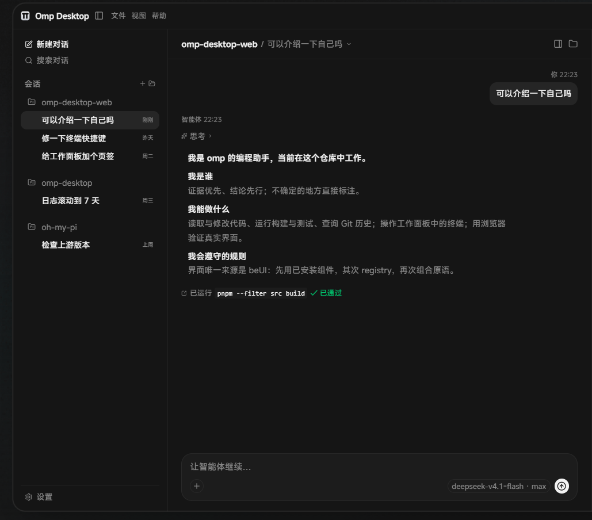

<div align="center">

# OMP Desktop

**The desktop form of omp, Stencil Labs' terminal coding agent.**

[Website](https://omp.auiox.com/) · [Documentation](https://omp.sh/docs) · [Releases](https://github.com/Arctic07/omp-desktop/releases) · [简体中文](README.zh-CN.md)

</div>



OMP Desktop is a Tauri 2 desktop application for omp. A React 19 / TypeScript interface talks to a Rust host that embeds the official omp SDK over a local NDJSON protocol, so real sessions, streaming turns, tools, terminal, Git, files, and plugins live in one window. The machine needs no separate omp, Node, or Bun install.

## Highlights

- **The real engine, not a mock.** One host process embeds `@oh-my-pi/pi-coding-agent`; conversations, model roles, thinking levels, tools, skills, MCP servers, and subagents come from the engine over IPC.
- **One window.** A conversation rail, streaming transcript, composer, and a work panel for terminal, Git, files, and the built-in browser.
- **Work where the conversation is.** Every conversation gets its own terminal tab, Git review, file preview, and browser tab; plugin-contributed tabs join the same panel.
- **Extensible.** Engine plugins, user skills, MCP servers, custom providers, and beUI-based plugin surfaces.
- **Local-first.** Sessions and logs stay in one application data root; API keys live in the OS credential store, never on disk.
- **Signature-verified updates.** Packaged builds check the GitHub release feed; an update is offered in the title bar and the About page, and the installer is verified against the bundled public key before it is installed.

## Requirements

- **Windows 10/11 x64** for the published installer. The code is cross-platform, but only Windows x64 artifacts are released.
- For a source build: Node.js 22+, pnpm 9, Bun 1.3+, Rust stable, and the Tauri 2 prerequisites. On Windows that means Visual Studio Build Tools with the MSVC x64 workload and the WebView2 runtime.

## Getting started

```bash
git clone https://github.com/Arctic07/omp-desktop.git
cd omp-desktop
pnpm install
pnpm host:install        # build the embedded host artifact
pnpm tauri:dev           # dev identity: com.omp.desktop.dev
```

`pnpm tauri:dev` is the only development command: it passes `src-tauri/tauri.dev.conf.json` and keeps the development data root apart from the installed application. A bare `pnpm tauri dev` takes the installed identity and is folded into the installed application by its single-instance lock, so it must not be used.

Build a release binary or installer:

```bash
pnpm tauri:build --no-bundle   # release binary in src-tauri/target/release
pnpm tauri:build               # NSIS and MSI bundles
```

A bundled build with updater artifacts needs `TAURI_SIGNING_PRIVATE_KEY`; the version and publishing policy lives in [`rules.md#release-versions-and-publishing`](rules.md#release-versions-and-publishing).

## Updates

A packaged build checks `https://github.com/Arctic07/omp-desktop/releases/latest/download/latest.json` 15 seconds after start and every 6 hours. The title-bar pill and the About page are the only places an update is offered; installing is always an explicit press. The first release that carries the updater must be installed by hand; later releases update in place.

## Data and uninstall

The application writes under one data root, `%LOCALAPPDATA%\com.omp.desktop` on Windows. The host pins `HOME` / `USERPROFILE`, `XDG_DATA_HOME`, `PI_CONFIG_DIR`, `OMP_DESKTOP_CODING_AGENT_DIR`, and `OMP_WORKTREE_DIR` inside it and refuses to start if a resolved path escapes. API keys are stored in the OS credential store under `com.omp.desktop`, never on disk.

To uninstall: quit the application, delete the data root, and remove the `com.omp.desktop` credential entries. The full path table and log-retention details are in the [Chinese README](README.zh-CN.md#数据落点与卸载).

## Project layout

```text
src/          React 19 + Vite + TypeScript frontend (beUI)
src-tauri/    Tauri 2 shell, Rust services, and the desktop binary
host/         The omp SDK host: one process, many sessions, NDJSON over stdio
scripts/      Build, check, and release helpers
```

## Development checks

```bash
pnpm --filter src typecheck
pnpm --filter src test
pnpm --filter src lint
(cd host && bun test)
cargo test --lib --manifest-path src-tauri/Cargo.toml
bun run check:upstream   # compares the pinned SDK with the npm latest; exit 10 means an update is available
```

## License

MIT. The desktop application embeds the MIT-licensed omp engine; the project's own terms are in [`LICENSE`](LICENSE), and the bundled engine and font notices are in [`THIRD_PARTY_NOTICES.md`](THIRD_PARTY_NOTICES.md).

## Links

- Website: <https://omp.auiox.com/>
- Documentation: <https://omp.sh/docs>
- Engine: <https://github.com/can1357/oh-my-pi>
- Releases: <https://github.com/Arctic07/omp-desktop/releases>
