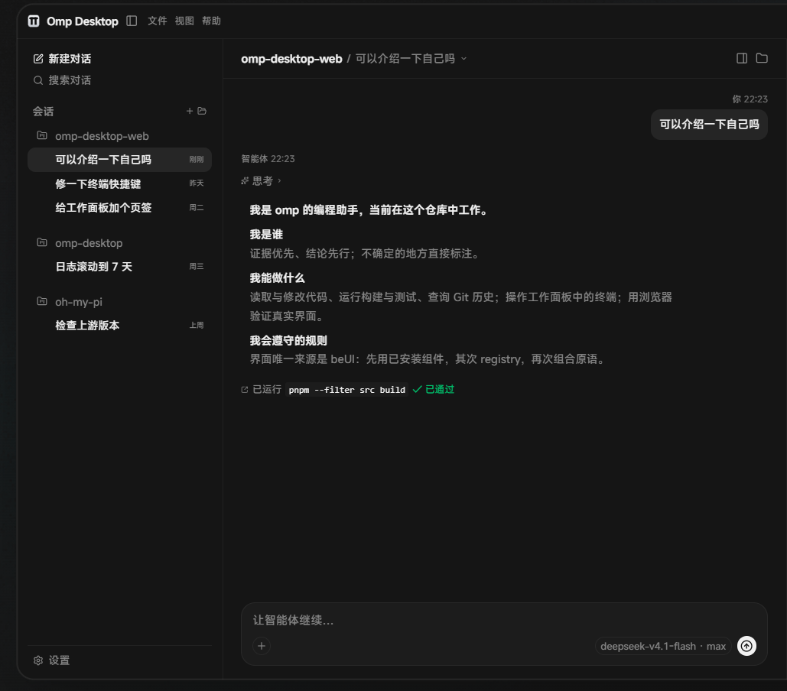

<div align="center">

# OMP Desktop

**omp（Stencil Labs 的终端编程智能体）的桌面形态。**

[官网](https://omp.auiox.com/) · [文档](https://omp.sh/docs) · [发布](https://github.com/Arctic07/omp-desktop/releases) · [English](README.md)

</div>



OMP Desktop 是 omp 的 Tauri 2 桌面应用。React 19 / TypeScript 界面通过本地 NDJSON 协议与一个内嵌官方 omp SDK 的 Rust 宿主通信，会话、流式回合、工具、终端、Git、文件与插件都在同一个窗口里。机器上不需要另外安装 omp、Node 或 Bun。

## 特性

- **真引擎，不是模拟。** 一个宿主进程内嵌 `@oh-my-pi/pi-coding-agent`；会话、模型角色、思考等级、工具、技能、MCP 服务器与子代理都通过 IPC 来自引擎。
- **一个窗口。** 会话栏、流式转录、输入区，以及终端、Git、文件和内置浏览器组成的工作面板。
- **在会话旁边工作。** 每个会话有自己的终端页签、Git 审查、文件预览和浏览器页签；插件贡献的页签也进入同一个面板。
- **可扩展。** 引擎插件、用户技能、MCP 服务器、自定义供应商，以及基于 beUI 的插件界面。
- **本地优先。** 会话与日志只落在一个应用数据根目录；API 密钥存放在操作系统凭据存储中，不写入磁盘。
- **签名校验更新。** 打包构建会检查 GitHub 发布源；标题栏和“关于”页提供更新入口，安装包在安装前会按随包公钥校验签名。

## 环境要求

- **Windows 10/11 x64**：当前发布安装包的平台。代码是跨平台的，但只发布 Windows x64 产物。
- 从源码构建：Node.js 22+、pnpm 9、Bun 1.3+、Rust stable，以及 Tauri 2 的前置依赖。Windows 上需要带 MSVC x64 工作负载的 Visual Studio Build Tools 和 WebView2 运行时。

## 开始使用

```bash
git clone https://github.com/Arctic07/omp-desktop.git
cd omp-desktop
pnpm install
pnpm host:install        # 构建安装包内置的宿主包
pnpm tauri:dev           # 开发身份：com.omp.desktop.dev
```

`pnpm tauri:dev` 是唯一的开发命令：它会传入 `src-tauri/tauri.dev.conf.json`，让开发数据根与已安装应用分开。直接运行 `pnpm tauri dev` 会使用已安装身份，被单实例锁折叠到已安装应用，并写入已安装应用的数据根，因此不要使用。

构建发布二进制或安装包：

```bash
pnpm tauri:build --no-bundle   # 发布二进制位于 src-tauri/target/release
pnpm tauri:build               # NSIS 与 MSI 安装包
```

带更新产物的打包构建需要 `TAURI_SIGNING_PRIVATE_KEY`；版本与发布规则见 [`rules.md#release-versions-and-publishing`](rules.md#release-versions-and-publishing)。

## 更新

打包构建会在启动 15 秒后检查 `https://github.com/Arctic07/omp-desktop/releases/latest/download/latest.json`，之后每 6 小时检查一次。标题栏药丸和“关于”页是唯一的更新入口；安装始终需要用户按下按钮。第一个带更新器的版本需要手动安装，之后的版本可以原地更新。

## 数据落点与卸载

应用只在一个数据根目录下写数据；Windows 上是 `%LOCALAPPDATA%\com.omp.desktop`。宿主把 `HOME` / `USERPROFILE`、`XDG_DATA_HOME`、`PI_CONFIG_DIR`、`OMP_DESKTOP_CODING_AGENT_DIR`、`OMP_WORKTREE_DIR` 全部 pin 到这个数据根，并逐个断言实际落点位于其中，越界即拒绝启动。API 密钥存放在操作系统凭据存储中（服务名 `com.omp.desktop`），不写入磁盘。

| 路径（相对数据根） | 内容 |
| --- | --- |
| `app.sqlite` | 应用自有状态（工作区列表、宿主偏好） |
| `logs/` | 应用日志 `app.log` 与宿主进程日志 `host.log`；按修改时间保留，当前正在写的文件不删除 |
| `EBWebView/` | WebView2 用户数据目录；“清除缓存”只清纯缓存子目录，不动 Local Storage、Network 与 Cookies |
| `scratch/` | 粘贴附件的临时副本；拖入的文件按原路径引用，不复制 |
| `workspace/` | 会话未指定工作目录时使用的默认工作区 |
| `home/` | 被 pin 的 `HOME` / `USERPROFILE` |
| `home/omp-desktop/` | 引擎配置根（`PI_CONFIG_DIR`）与引擎自己的日志 |
| `home/.omp/natives/` | 原生 addon 的解压缓存 |
| `home/.bun/` | Bun 包缓存 |
| `host/agent/` | 引擎数据目录（`OMP_DESKTOP_CODING_AGENT_DIR`）：引擎数据库与导入的会话文件 |
| `host/sessions/` | 会话记录，每会话一个 `*.jsonl` |
| `host/xdg/omp/` | 引擎的 `XDG_DATA_HOME` |
| `host/worktrees/` | `OMP_WORKTREE_DIR`，引擎的 worktree 基线 |

各类保留上限与回收阈值由对应服务的常量决定，不在文档里复制。

### 卸载

1. 退出应用。
2. 删除数据根目录（Windows：`%LOCALAPPDATA%\com.omp.desktop`）。
3. 在操作系统凭据存储中删除服务名 `com.omp.desktop` 下的条目，否则 API 密钥会残留。

## 项目结构

```text
src/          React 19 + Vite + TypeScript 前端（beUI）
src-tauri/    Tauri 2 外壳、Rust 服务与桌面二进制
host/         omp SDK 宿主：一个进程、多会话、stdio 上的 NDJSON
scripts/      构建、检查与发布脚本
```

## 开发检查

```bash
pnpm --filter src typecheck
pnpm --filter src test
pnpm --filter src lint
(cd host && bun test)
cargo test --lib --manifest-path src-tauri/Cargo.toml
bun run check:upstream   # 对比锁定的 SDK 与 npm latest；退出码 10 表示有更新
```

## 上游 SDK 版本检查

`bun run check:upstream` 读取 `host/package.json` 里 `@oh-my-pi/pi-coding-agent` 的锁定版本，向 npm registry 取一次 `latest`，打印一行 `upstream <v> / local <v> (<status>)`；只读文件 + 一次 GET，无副作用。

退出码：`0` 已最新；`10` 上游有新版本；`1` 读取或网络失败、或版本无法比较（如上游是预发布），原因打印在 stderr，不静默。

## 许可证

MIT。桌面应用内嵌 MIT 授权的 omp 引擎；本项目自身条款见 [`LICENSE`](LICENSE)，随包分发的引擎与字体声明见 [`THIRD_PARTY_NOTICES.md`](THIRD_PARTY_NOTICES.md)。

## 链接

- 官网：<https://omp.auiox.com/>
- 文档：<https://omp.sh/docs>
- 引擎：<https://github.com/can1357/oh-my-pi>
- 发布：<https://github.com/Arctic07/omp-desktop/releases>
